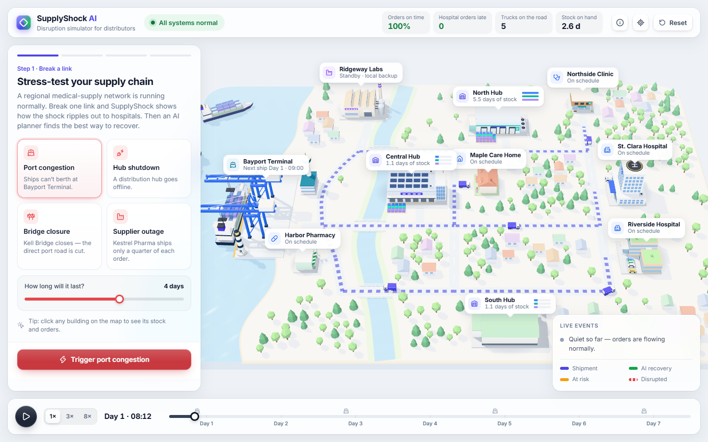
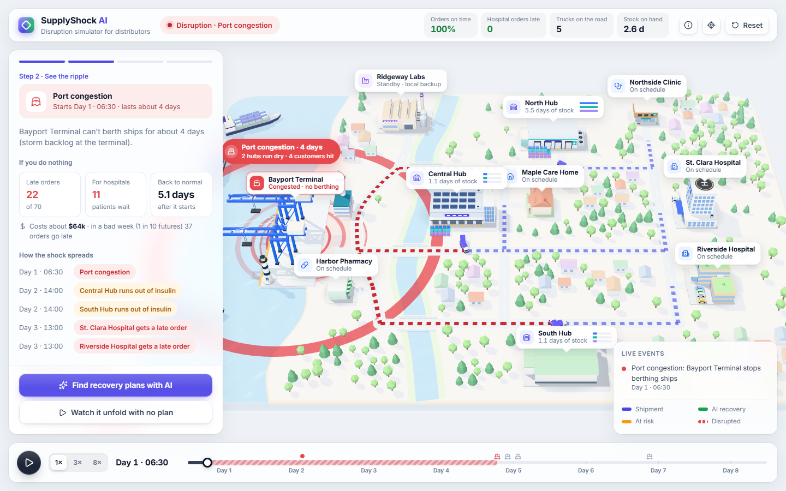
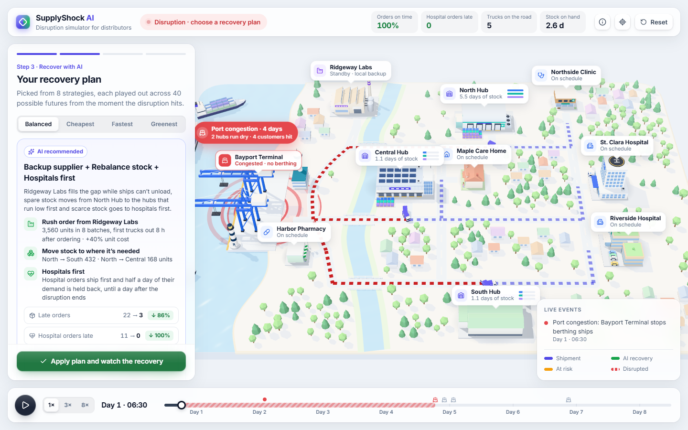
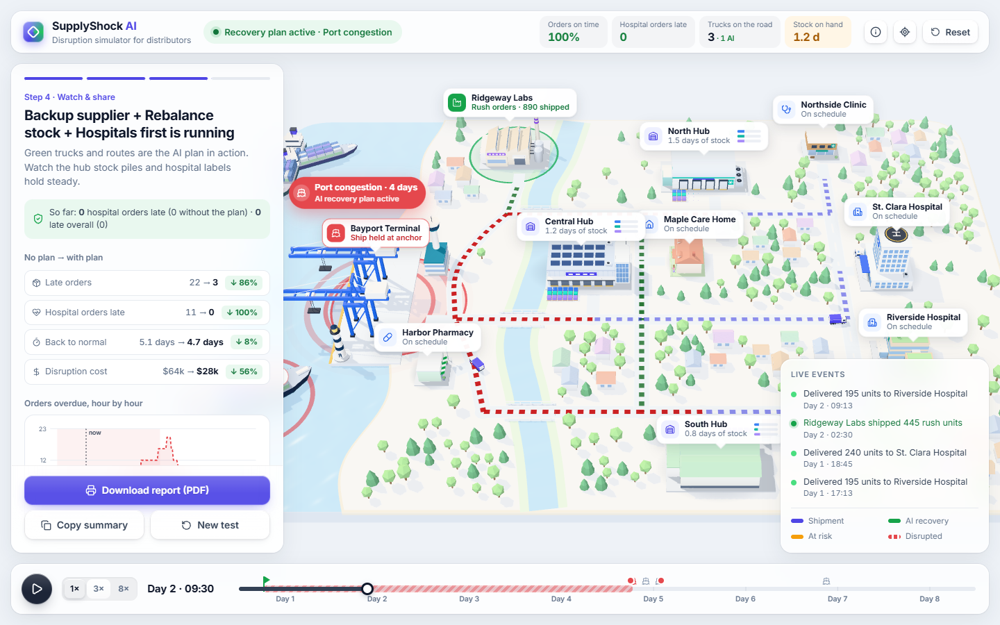

# SupplyShock AI

**When one link breaks, who runs out first?**
SupplyShock AI is a disruption simulator for distributors. Break one link of a supply chain on a live 3D model: close the port, shut a hub, close a bridge or cut a supplier. Watch the shock ripple out to hospitals, then let an AI planner rehearse every recovery option across many possible futures and recommend the best one.

**▶ Live demo: [supplyshock-ai.vercel.app](https://supplyshock-ai.vercel.app)** — runs entirely in your browser (desktop Chrome, Edge or Firefox recommended).



## The problem

A ship stuck outside a port on Monday can leave a hospital without insulin by Wednesday. Large companies run expensive planning suites that model this. Small and mid-sized distributors usually find out when a customer calls about a missing delivery. They can't see:

- **the ripple:** which hubs run dry, which customers are hit, and when;
- **the cost:** late deliveries, emergency trucking, rush orders;
- **the best response:** rush order, move stock, reroute, or ration — and in what combination.

## What it does

1. **Break a link.** Pick one of four disruptions and how long it lasts, or click a building on the map.
2. **See the ripple.** The clock pauses, a shockwave spreads from the disruption, and supply routes turn red. The panel shows what happens if you do nothing: late orders, hospital orders late, time to recover, cost, and the chain of events hour by hour.
3. **Recover with AI.** The planner tests every combination of recovery levers:
   - rush order from a local backup supplier;
   - rebalance stock between hubs;
   - reroute around the disruption;
   - serve hospitals first.

   Each combination is simulated in an expected week plus 40 randomized futures, shown live as a grid: one row per strategy, one square per future, green when every hospital order arrived on time. The planner recommends a plan with concrete steps, before → after results and a confidence figure ("every hospital order on time in 40 of 40 futures"). It prefers robust plans and says why: *"Why not Backup supplier + Rebalance stock? Fewer late orders in the expected week (0 vs 3), but a hospital order goes late in 19 of 40 futures."* You can switch the objective (Balanced, Cheapest, Fastest, Greenest) and compare all strategies.
4. **Watch it recover and share it.** Apply the plan: the week replays from the moment the disruption hits, with green trucks and routes carrying the AI's moves while live progress tracks against "do nothing". Download a printable report ([sample PDF](docs/sample-report.pdf)) or copy a summary.

| 1 · See the ripple | 2 · AI recovery plan | 3 · Watch it recover |
|---|---|---|
|  |  |  |

## How it works

```
network data ──► discrete-event simulator ──► 3D map + panels (what you watch)
                      ▲
                      └── AI planner: every lever combination × 40 futures → ranked plans
```

- **Simulator** (`src/sim/engine.js`) plays the week hour by hour:
  - customers order;
  - hubs dispatch trucks;
  - a container ship restocks the port every two days;
  - the port restocks the hubs over a road network with a river and three bridges.

  Disruptions bend that flow: a ship held at anchor, a hub offline, a bridge closed, or a short shipment whose backlog follows on later sailings. Every truck trip, stock level and order is recorded, and the 3D map simply plays that record back. What you see is exactly what the AI evaluated.
- **AI planner** (`src/sim/planner.js`) is a simulation-based planning agent: search over strategy combinations plus Monte Carlo risk analysis.
  - Uncertainty: order sizes ±15%, travel times ±8%, and the disruption's real length −20% to +35%.
  - Ranking: a late hospital order outweighs any saving in cost, speed or CO₂ under every objective, so no plan "saves money" by letting patients wait. Near-ties (within Monte Carlo noise) go to the simpler plan, so it never recommends a lever that changes nothing.
  - Explanations are generated from the simulated numbers (`src/sim/explain.js`).
  - About 330–650 simulations run in under a second, right in the browser. No server and no API keys.
- **3D map** (`src/scene/`) uses Three.js:
  - a diorama board with coast, river and bridges;
  - instanced trees and homes;
  - animated status-coloured route lines (indigo normal, green AI recovery, amber at risk, red disrupted);
  - stock piles that rise and fall;
  - ships that berth, wait at anchor or queue offshore.
- **Blender asset pipeline** (`blender/build_assets.py` + `blender/landmarks.py`) generates all 21 low-poly models in code. Every landmark has its own design:
  - **hubs:** a solar-roofed cross-dock, a cold-chain store with refrigeration units, and a twin-roof distribution centre;
  - **hospitals:** a glass tower with a helipad and an ambulance, and a sandstone campus with green roofs and a sky-bridge;
  - **other sites:** a timber clinic, a pharmacy with a striped awning, a care home with a garden fence, and a factory with pipes and tanks;
  - **port:** a control tower and a lighthouse, plus the container ship, cranes, trucks and props.

  The script exports them as one GLB (`public/models/supplyshock.glb`, about 13k triangles). At load time each model is baked into a single vertex-coloured mesh with soft ground occlusion, so the whole city draws in about 140 draw calls.

## Run it

Requires Node 20.19+ (or 22.12+) and a browser with WebGL.

```bash
npm install
npm run dev        # open http://localhost:5173
npm test           # 13 simulator + planner tests
npm run build      # static site in dist/
npm run assets     # rebuild the 3D models (needs Blender on your PATH)
```

Deployed on Vercel as a static Vite site (`vercel.json`). The Vercel project is linked to this repository, so every push to `main` redeploys the live demo.

Controls: drag to orbit, scroll to zoom, click a building for details. <kbd>Space</kbd> plays or pauses, the arrow keys move along the focused timeline, <kbd>Esc</kbd> closes a card.

## Project structure

```
src/data/network.js    the demo business: sites, roads, products, demand, scenarios
src/sim/               simulator, routing, AI planner, explanations, queries
src/scene/             Three.js map: terrain, sites, vehicles, effects
src/ui/                app flow, charts, report, icons
blender/               procedural 3D asset pack
tests/                 node:test suite for the simulator and planner
docs/                  README screenshots and a sample disruption report (PDF)
devpost/               planning docs from the Devpost Learn skill pack (scope, PRD, spec, checklist, app map)
```

## Built with

- [Three.js](https://threejs.org/) (MIT) — rendering
- [Blender](https://www.blender.org/) — 3D asset generation (assets are produced by our own script)
- [Vite](https://vite.dev/) (MIT) — dev server and build
- [Lucide](https://lucide.dev/) (ISC) — icons
- [Inter](https://rsms.me/inter/) via Google Fonts (OFL)
- [Devpost Learn skill pack](https://github.com/challengepost/learn-ai-basics) (MIT, © Devpost) — planning workflow (`.agents/skills/`, `devpost/`)

### AI assistance

This project was built with **Claude Code** (Anthropic) as an AI pair-programmer, guided by the Devpost Learn skill pack. The team chose the idea, the target users, the visual direction (white UI, Three.js + Blender, a 3D city with ships and trucks) and reviewed the result. Claude Code wrote most of the code, the Blender script and the documentation. See `devpost/` for the planning documents.

The demo network, companies and places are fictional.

## License

[MIT](LICENSE)
